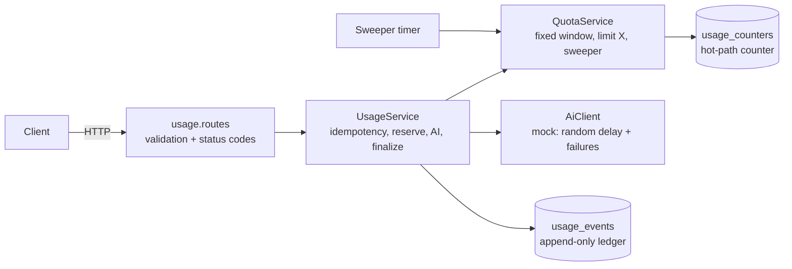
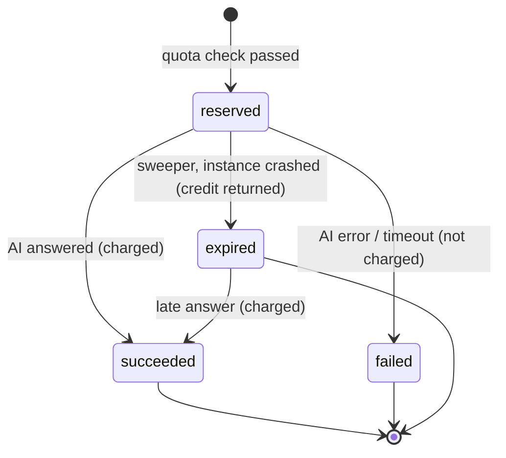

# AI Usage Metering & Quota System: Design

**Goal:** every AI request uses one credit; every credit used is stored as evidence (billing, audits, disputes); each user may make at most **X** requests per period, with X configurable.

Legend: ✅ implemented in this repo · 📐 design only (production)

---

## 1. Architecture

### Local (✅ implemented)



One Node.js process (Fastify) with SQLite embedded in-process (one local file, WAL mode). Layers: **routes** (HTTP only) → **services** (business rules, own the transactions) → **repositories** (SQL only).

### Request flow: reserve → call AI → commit or release

```mermaid
sequenceDiagram
  participant C as Client
  participant API as API instance
  participant DB as Database
  participant AI as AI provider
  C->>API: POST /v1/users/alice/ai-requests (Idempotency-Key?)
  API->>API: validate input (400 if invalid)
  API->>DB: TX: key seen? replay. Else reserve 1 credit if used+reserved < X, insert event 'reserved'
  alt quota exhausted
    API-->>C: 429 + Retry-After (nothing written to the ledger)
  end
  API->>AI: call (outside any lock, hard timeout)
  alt success
    API->>DB: TX: event 'succeeded'; counter reserved-1, used+1
    API-->>C: 200 {result, charged: true, usage}
  else failure / timeout
    API->>DB: TX: event 'failed'; counter reserved-1
    API-->>C: 502 / 504 {charged: false, usage}
  end
```

**Key point:** the slow AI call is never inside a transaction. Each write lock is held for microseconds, so latency is dominated by the AI call, not by metering.

### Record lifecycle



### Production (📐)

<!-- Lucidchart production architecture: export as PNG to docs/images/production-architecture.png, then uncomment the next line.

-->

Stateless API instances behind a load balancer → **Postgres** (counters + ledger, same transactional model, sharded by `user_id`) → billing consumes ledger changes through an **outbox → event stream**. Redis is optional as a read cache for `GET /usage`, never as the source of truth.

---

## 2. Data model

**`usage_events`**: the append-only evidence ledger (one row per attempt that passed the quota check).

| Field | Why it's stored |
|---|---|
| `id` (UUID) | Reference to give a customer in a dispute |
| `user_id` | Who used the credit |
| `idempotency_key` (unique per user) | Retries can never create a second charge |
| `request_hash` (HMAC-SHA256 of user id + prompt, keyed by a server secret), `prompt_chars` | Proves *what* was asked without storing the text (privacy); the secret prevents cross-user correlation and guessing |
| `period_start` | Exactly which window the credit counted against |
| `quota_limit` | The limit in force at that moment (evidence if X changes later) |
| `status`: reserved / succeeded / failed / expired | Lifecycle. **Only `succeeded` is charged** |
| `error_code` | AI_ERROR / AI_TIMEOUT / RESERVATION_EXPIRED |
| `created_at`, `finalized_at`, `latency_ms` | Audit timeline (server clock only) |
| `instance_id` | Which server handled it (multi-instance debugging) |
| `response_body` | Only so an idempotent retry can replay the answer (see trade-offs) |

**Tamper-proofing (✅):** DB triggers reject `DELETE`, reject illegal status transitions (only those in the lifecycle diagram), and reject any change to identity/evidence columns.

**`usage_counters`**: `(user_id, period_start) → used, reserved`. The quota check is one primary-key row instead of `COUNT(*)` over the ledger. It is **always updated in the same transaction** as the ledger row, so the two cannot drift (a test checks `used = count(succeeded)` and `reserved = count(reserved)`).

---

## 3. How the quota is enforced

**Algorithm: fixed window**, aligned to the epoch: `periodStart = floor(now / P) * P`. Windows are the same for all users (e.g. 10:00–11:00); the start is inclusive and the end exclusive.

**Atomic check-and-reserve:** one conditional statement inside a `BEGIN IMMEDIATE` transaction:
```sql
UPDATE usage_counters SET reserved = reserved + 1
 WHERE user_id = ? AND period_start = ? AND used + reserved < :limit
```
It either reserves a credit or changes nothing. `IMMEDIATE` takes the write lock up front, so two requests (or two processes) can never both see "1 credit left". In Postgres (📐) the same statement with `RETURNING` takes a row lock on that user's counter row only.

**Reserve → commit/release:** in-flight requests hold a reserved credit (so concurrent requests can't overshoot), success converts it to `used`, failure releases it. Failed attempts are **not charged but are recorded**.

**Why fixed window over the alternatives:**

| Algorithm | Exact? | Cost per check | Fits "X per period" billing? |
|---|---|---|---|
| **Fixed window** ✅ | Exact | O(1) | Yes: the period on the bill is the period in the DB |
| Sliding window log | Exact | O(n) per user | No fixed period to bill |
| Sliding window counter | Approximate | O(1) | "About X" can't be defended in a dispute |
| Token bucket | Exact for its own rules | O(1) | Continuous refill, no reset date; built for traffic smoothing |
| Leaky bucket | n/a | O(1) + queue | Queuing adds latency |

This is a **billing quota**, not a traffic limiter: fixed windows give exact, reproducible numbers (invoice = audit = dispute), constant storage, and a precise `Retry-After`. If burst protection is ever needed, put a separate token-bucket rate limiter in front, so each algorithm does the job it's built for.

---

## 4. Edge cases

The most important ones, grouped. **All 45, with how each is handled and its test, are in [EDGE_CASES.md](EDGE_CASES.md)**; the `#` numbers below and elsewhere in this document refer to that list.

| Area | Edge case | Handling |
|---|---|---|
| Concurrency | 1 credit left, many simultaneous requests (#1); several instances on one DB (#2) | Atomic conditional reserve; the lock is in the DB, so exactly X succeed even across processes |
| Retries | Client retries (#3); same key, different body (#4); same key still running (#5) | `Idempotency-Key`: replay without a new charge; 422; 409 |
| AI failures | AI fails (#6) or hangs (#7) | Recorded as `failed`, not charged; hard timeout → 504, credit released |
| Crashes | Crash between reserve and finalize (#8); AI answers after expiry (#9) | Sweeper expires stale reservations and returns the credit; a late success is still charged |
| Period boundaries | Request exactly on a boundary (#10) or in flight across it (#11) | One server timestamp, end exclusive; charged to the period it was reserved in |
| Limit changes | X lowered below usage (#12); X = 0 (#14, #27) | `remaining` never negative; history untouched; X = 0 → 429 without a misleading `Retry-After` |
| Evidence | Ledger tampering (#18); counter drifting from the ledger (#19, #41) | DB triggers block deletes and illegal edits; counter and ledger written in one transaction, mismatches roll back loudly |
| Privacy | Prompt hashes correlating users or guessable (#28) | HMAC keyed by a server secret and the user id |
| Storage down | DB unavailable or locked (#22) | Fail closed: 503, the AI is never called without recording evidence |
| Input | Invalid input, invisible-only prompts, oversized bodies (#16, #38, #39) | Rejected with 400 before any credit is touched |
| Operations | Graceful shutdown (#23, #35, #37); crash exit code (#36); misconfiguration (#15, #42–#44) | Waits for in-flight requests with a deadline; exit 1 after a crash; clear startup errors, including timer values Node can't hold |
| Known limits | Late starters get less time (#25); clock jumps (#45); client disconnects (#21) | By design / documented; production takes time from the DB |

---

## 5. Failure handling

| Component | What happens |
|---|---|
| **Database down / slow** | Wait up to `busy_timeout`, then **503 and no AI call**: no credit without evidence (**fail closed**). `/health` reports 503. If it fails *after* the AI call (during finalize, including the connection being closed mid-request), the client gets 503, the reservation stays `reserved`, and the sweeper releases it (the user is not charged). |
| **AI slow** | Hard timeout → 504, credit released. 📐 Add a circuit breaker so a failing provider is rejected fast instead of every request waiting for the timeout. |
| **AI failing** | 502, not charged, recorded. |
| **Instance crash** | Its reservations stay `reserved` and are expired by the sweeper (on any instance, at startup and on a timer). Credits come back; rows stay as evidence. A process that hits an uncaught exception exits with code 1 so it gets restarted (#36). |
| **Shutdown stuck** | Hard deadline, then forced exit with code 1 (#37). |
| **Counter/ledger inconsistency** | Detected at finalize; the transaction rolls back and the error is logged instead of silently drifting (#41). |
| **Redis down** (📐) | Redis is only a read cache, so fall back to the DB. |

---

## 6. Scaling to many users and instances (📐 unless noted)

- **Stateless instances** (✅ already true): all state is in the DB, so instances can be added freely; the 3-process test proves correctness across instances.
- **Contention is per user:** each reservation locks only that user's counter row. Thousands of users proceed in parallel; only one user's own concurrent requests serialize, for microseconds.
- **Shard by `user_id`:** every query is keyed by user, so the data splits cleanly across Postgres shards.
- **Ledger growth:** partition `usage_events` by month; archive old partitions to cold storage for audits.
- **Billing:** an outbox table + event stream (e.g. Kafka) so billing never queries the hot tables.
- **Reads:** `GET /usage` is a single primary-key lookup; a short-TTL cache can absorb heavy polling.

---

## 7. Trade-offs

| Chose | Rejected | Why |
|---|---|---|
| Fixed window | Sliding window / token bucket | Exact and billable; O(1); see §3. Cost: bursts around a boundary, and late starters get less time |
| Charge only on success | Charge every attempt | Fair to users and easy to defend in a dispute. Failed attempts are still recorded |
| Reserve before calling the AI | Count after the call | Prevents concurrent overshoot. Cost: an in-flight request holds a credit |
| Fail closed when the DB is down | Fail open | Evidence is the requirement; serving without recording would create unbillable, undisputable usage |
| Counter table + ledger | `COUNT(*)` on every request | O(1) check; kept consistent by the shared transaction |
| DB as source of truth | Redis-only counting | Redis can lose writes on failover, losing evidence |
| `DB_SYNC=FULL` by default | `NORMAL` by default | A committed credit survives a power loss. Cost: a disk wait per commit, and because better-sqlite3 is synchronous that wait blocks the event loop (#34). Configurable; 📐 production uses an async Postgres driver |
| Store an HMAC of the prompt | Store the prompt / a plain hash | Enough for disputes without keeping personal data, and no cross-user correlation (#28). **Exception:** `response_body` is kept to replay idempotent retries; 📐 in production move it to a separate store with a 24-hour expiry |
| Late success after expiry is charged | Discard it | The user received the answer. Cost: a crash-recovery race can overshoot X by the number of in-flight requests (rare, logged) |
| Same-key retry after a failure replays the failure | Retry the AI call | Standard idempotency semantics (one key = one outcome); the client uses a new key to try again |
| Single global X | Per-user plans | Out of scope; 📐 a `user_limits` table read inside the same transaction |

**Left out (by choice):** authentication, per-user plans/admin API, circuit breaker, Postgres/Redis deployment, calendar-month periods (the window here is a fixed number of seconds; calendar months need date math, not division).
